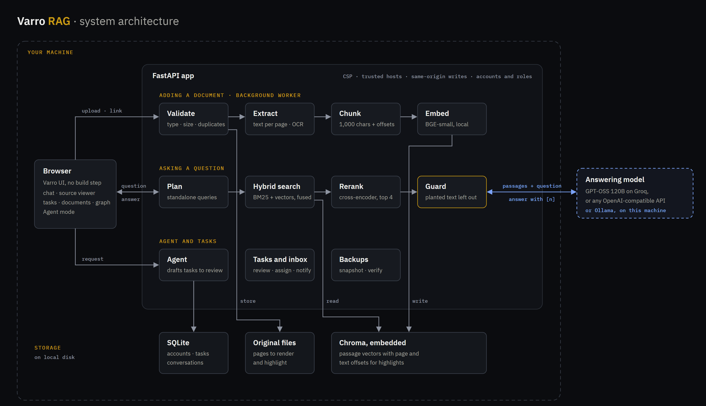

# Varro RAG

**Ask your documents. Check every answer.**

**Status: Under implementation** · Planned public release: **week of November 9, 2026**

Varro RAG is a local-first, document-grounded assistant for asking questions, checking cited evidence, and turning document instructions into human-reviewed work. It combines retrieval-augmented generation (RAG) with an agent that can search a workspace, prepare task drafts, and suggest notes or updates for a person to review.

> This private repository is a project overview with the demo and architecture images; the application source remains in the private development repository while implementation continues. The public release is planned for next week; the schedule may change as development and review progress.

## What it does

- Answers questions using passages retrieved from a user's documents, with citations that link back to the source and relevant PDF page.
- Searches with both semantic embeddings and keyword retrieval, then reranks candidate passages.
- Reads PDF, DOCX, TXT, Markdown, and web pages. Optional local OCR supports scanned PDFs.
- Helps teams organize documents and conversations into workspaces with viewer, member, manager, and admin roles.
- Provides an agent that can find and compare documents, recall a user's earlier conversations, explore workspace links, and draft tasks or notes.
- Keeps agent changes reviewable: tasks, comments, notes, and proposed updates wait for a person to approve them before they take effect.
- Supports Groq, OpenAI-compatible model providers, and Ollama for local model use. Embeddings, retrieval, and storage run locally with the application.

## How it works

Documents are validated, extracted, split into passages, and indexed. A question is searched through semantic and keyword retrieval; the strongest passages are reranked and provided to the selected answer model. Answers cite those passages so readers can inspect the evidence. The agent can use the same workspace information to prepare drafts, while access follows the signed-in person's role.

With a hosted model provider, the question and retrieved passages are sent to that provider to generate an answer. With a local model through Ollama, those model requests can stay on the user's machine. Provider privacy policies and deployment configuration should be reviewed before using sensitive documents.

## Implemented so far

- FastAPI application with a browser-based interface.
- Document ingestion, background processing, hybrid retrieval, reranking, citations, and PDF page viewing.
- Conversations, summaries, suggested questions, and workspace organization.
- Team accounts, role-based access, tasks, comments, checklists, activity history, and notifications.
- Agent mode for document research, task drafting, notes, and reviewed proposals.
- Local backups and restore support.
- Evaluation scripts, security-focused tests, setup and operations documentation, and a ready-made fictional demo workspace.

## Evaluation so far

Results below come from small, self-authored evaluation sets and are useful as project regression checks; they are not independent benchmarks.

| Evaluation | Result |
|---|---:|
| Correct passage in top 2 / top 4 | 0.93 / 0.99 |
| Answerable questions answered with all needed pages cited | 51 / 51 |
| Unanswerable questions refused | 11 / 11 |
| Planted prompt-injection attacks resisted end to end | 34 / 34 |
| Expected tasks found across two drafting runs | 18 / 18 and 17 / 18 |
| Search at 3,000 documents: median fact-found query | 162 ms |

## Security and privacy approach

The implementation includes upload type and size checks, access checks for workspaces and documents, restrictions on server-side web fetching, request limits, security headers, and review steps for agent-generated changes. Prompt-injection screening is heuristic and cannot guarantee detection of every malicious instruction. The application is designed for a single machine and has not been load-tested for large multi-user deployments.

For deployments beyond a personal computer, authentication, HTTPS, allowed hosts and origins, persistent storage, backups, model-provider data handling, and resource limits need careful configuration.

## Technology

- **Backend:** Python 3.11+, FastAPI, SQLite
- **Retrieval:** Chroma in embedded mode, BM25, sentence-transformer embeddings, and a cross-encoder reranker
- **Models:** Groq, OpenAI-compatible APIs, or Ollama
- **Documents:** PDF, DOCX, TXT, Markdown, web pages, with optional OCR
- **Frontend:** HTML, CSS, and JavaScript modules

## Project status

The system has a working implementation, evaluation tooling, and documentation, but development is still underway. This overview and its visual assets are being shared privately while the implementation receives further work and review. A public source release is planned for the week of November 9, 2026.

More details, installation instructions, and the source code will be provided with the public release.

## License

This overview repository is licensed under the MIT License. See [LICENSE](LICENSE).
